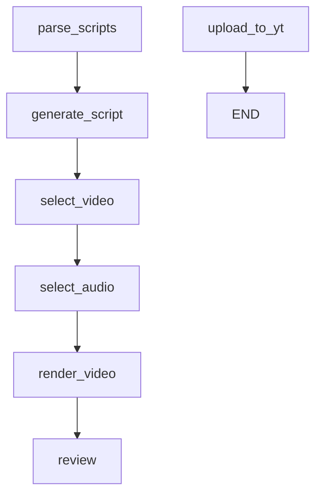
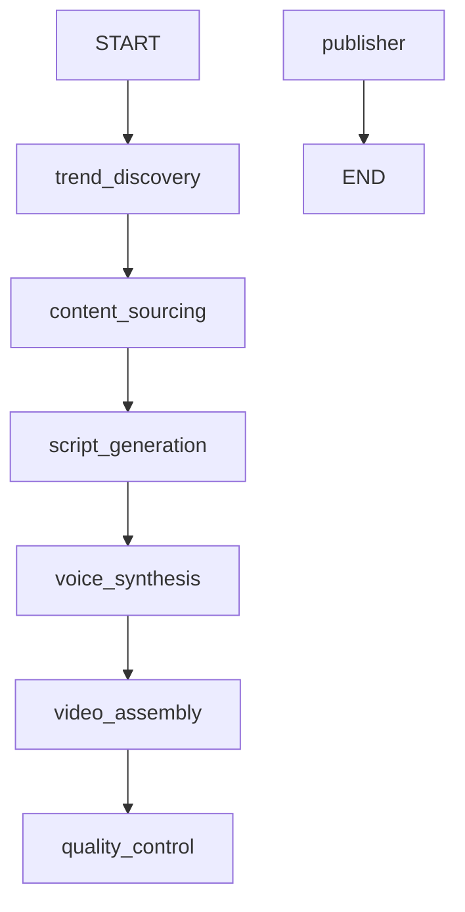
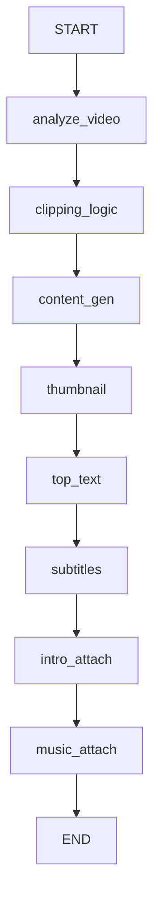
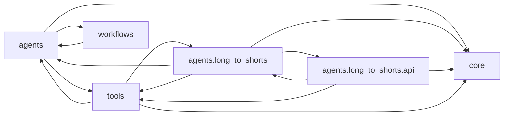

# Repository Map (auto-generated)

> Generated by `scripts/gen_repo_map.py` on 2026-07-21 17:59 UTC. **Do not edit by hand** — run `make repo-map` (or `python scripts/gen_repo_map.py`). Narrative docs live in the other `docs/claude/*.md` files.

## Source tree

```
agents/
└── long_to_shorts/  (58 .py)
    └── api/  (41 .py)
        └── db/  (11 .py)
tools/
├── llm/  (8 .py)
├── tts/  (6 .py)
├── video_editing/  (4 .py)
└── youtube/  (3 .py)
core/
└── execution/  (4 .py)
workflows/
supabase/migrations/
```

## LangGraph graphs

### `agents/graph.py`

- **Nodes (9):** `parse_scripts`, `generate_queries`, `fetch_assets`, `generate_script`, `select_video`, `select_audio`, `render_video`, `review`, `upload_to_yt`
- **Edges:**



### `workflows/graph.py`

- **Nodes (7):** `trend_discovery`, `content_sourcing`, `script_generation`, `voice_synthesis`, `video_assembly`, `quality_control`, `publisher`
- **Edges:**



### `agents/long_to_shorts/graph.py`

- **Nodes (8):** `analyze_video`, `clipping_logic`, `content_gen`, `thumbnail`, `top_text`, `subtitles`, `intro_attach`, `music_attach`
- **Edges:**



## API route map

| Router | Method | Path |
|---|---|---|
| `billing_routes.py` | POST | `/api/v1/billing/checkout` |
| `billing_routes.py` | GET | `/api/v1/billing/plans` |
| `billing_routes.py` | POST | `/api/v1/billing/webhook/razorpay` |
| `billing_routes.py` | POST | `/api/v1/billing/webhook/stripe` |
| `discover_routes.py` | POST | `/api/v1/discover` |
| `discover_routes.py` | GET | `/api/v1/discover/suggestions` |
| `discover_routes.py` | POST | `/api/v1/discover/suggestions/seen` |
| `discover_routes.py` | GET | `/api/v1/discover/topics` |
| `edit_routes.py` | POST | `/api/v1/edit/add-music` |
| `edit_routes.py` | POST | `/api/v1/edit/generate-thumbnail` |
| `edit_routes.py` | GET | `/api/v1/edit/jobs` |
| `edit_routes.py` | GET | `/api/v1/edit/jobs/{edit_job_id}` |
| `events_routes.py` | GET | `/api/v1/edit/jobs/{edit_job_id}/events` |
| `edit_routes.py` | POST | `/api/v1/edit/split-screen` |
| `edit_routes.py` | POST | `/api/v1/edit/tts` |
| `edit_routes.py` | POST | `/api/v1/edit/tts/script` |
| `edit_routes.py` | POST | `/api/v1/edit/uploads` |
| `routes.py` | GET | `/api/v1/jobs` |
| `routes.py` | POST | `/api/v1/jobs` |
| `routes.py` | GET | `/api/v1/jobs/{job_id}` |
| `events_routes.py` | GET | `/api/v1/jobs/{job_id}/events` |
| `routes.py` | POST | `/api/v1/jobs/{job_id}/rerun` |
| `llm_routes.py` | DELETE | `/api/v1/llm/credentials` |
| `llm_routes.py` | GET | `/api/v1/llm/credentials` |
| `llm_routes.py` | PUT | `/api/v1/llm/credentials` |
| `music_routes.py` | POST | `/api/v1/music/refresh` |
| `music_routes.py` | GET | `/api/v1/music/search` |
| `music_routes.py` | POST | `/api/v1/music/songs` |
| `music_routes.py` | GET | `/api/v1/music/themes` |
| `music_routes.py` | DELETE | `/api/v1/music/tracks` |
| `music_routes.py` | GET | `/api/v1/music/tracks` |
| `music_routes.py` | POST | `/api/v1/music/tracks` |
| `music_routes.py` | GET | `/api/v1/music/trending` |
| `routes.py` | GET | `/api/v1/usage` |
| `youtube_routes.py` | DELETE | `/api/v1/youtube/auth` |
| `youtube_routes.py` | GET | `/api/v1/youtube/auth/callback` |
| `youtube_routes.py` | GET | `/api/v1/youtube/auth/login` |
| `youtube_routes.py` | GET | `/api/v1/youtube/auth/status` |
| `youtube_routes.py` | POST | `/api/v1/youtube/upload` |
| `youtube_routes.py` | GET | `/api/v1/youtube/uploads` |
| `youtube_routes.py` | GET | `/api/v1/youtube/uploads/{upload_id}` |
| `events_routes.py` | GET | `/api/v1/youtube/uploads/{upload_id}/events` |

## Module dependency graph

Top-level package imports (should point downward: api → nodes → tools → core).


